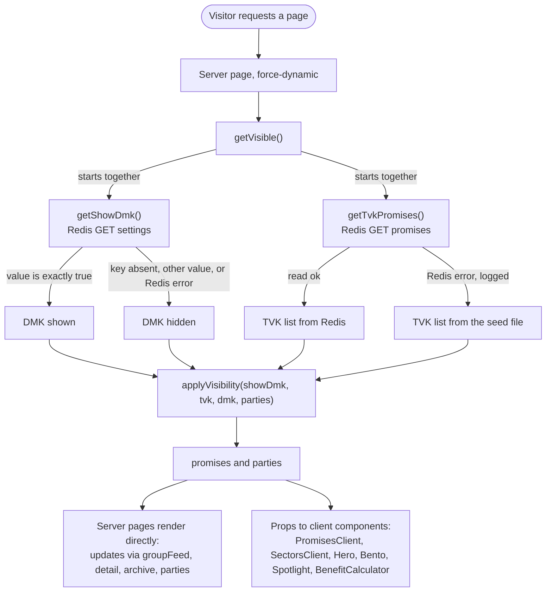
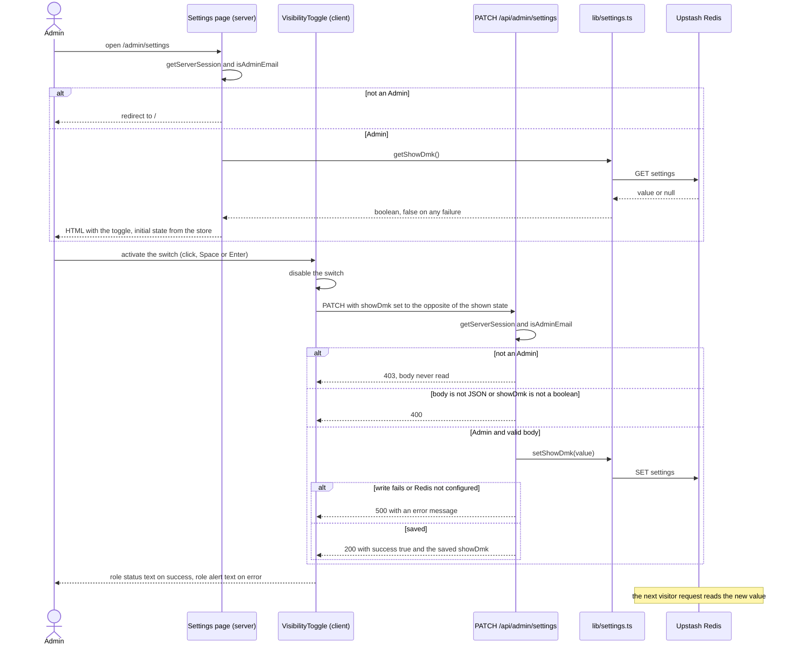

# Design Document

## Overview

The Updates feed stops repeating itself, and DMK content becomes a runtime switch. Both changes depend on one shared loader, because a runtime switch only works on pages that read live data.

- **Feed.** `groupFeed` is a pure function that turns the promises into cards. Sources that cite the same link on the same date become one card that lists every related promise and keeps the per-promise notes. `/updates` renders the cards in a server component and collapses long lists with a native `details` element, so no client JavaScript is added.
- **Switch.** One boolean in Upstash Redis under the key `settings`, an Admin-only PATCH route, and a switch on `/admin/settings`. DMK is shown only when the stored value is exactly `true`.
- **Loader.** `getVisible()` in `lib/promiseStore.ts` reads the setting and the TVK promises at the same time and returns the visible promises and parties. Eight pages use it. Six of them (`/`, `/updates`, `/sectors`, `/parties`, `/impact`, `/archive/[slug]`) move from static JSON to the live loader and to explicit per-request rendering; the first five are prerendered at build time today. This replaces criterion 2 of Requirement 7 of `upstash-promises-integration` and the matching sentence in its Introduction (Requirement 14.1). The text of that spec is not edited.

Measured on the repository data: 56 TVK promises (`data/promises.json`, 91,006 bytes), 142 DMK promises (`data/dmk-promises.json`, 223,886 bytes), and 252 Sources (64 TVK, 188 DMK). The grouper in this document, run under Node type stripping on that data, returns 8 cards with DMK hidden and 13 with DMK shown, which matches the requirements.

The design stays small and follows the existing code:

- No new dependency. `lib/kv.ts` and the tolerant-read pattern of `lib/promiseStore.ts` are reused as they are.
- The logic that decides what visitors see is pure and has a runnable check, the way `lib/approval.ts` does: `groupFeed`, and the two settings rules `parseShowDmk` and `applyVisibility`.
- `getVisible()` replaces `getLivePromises`, so exactly one function applies the setting.
- Pages stay server components. Client components receive promises as props.

### Design points

| Point | Decision |
| --- | --- |
| Setting storage | Key `settings`, value `{ "showDmk": boolean }`, read and written only through `kvGet` and `kvSet`. The key holds nothing else. |
| Read rule | Strict on the value, tolerant on failure. Only an object whose `showDmk` is the boolean `true` shows DMK. A missing key, any other value, or any Redis failure hides it, and failures are logged. Every call reads Redis. |
| Loader | `getVisible()` in `lib/promiseStore.ts`. It starts the setting read and the TVK read together and returns `{ promises, parties }` built from one setting value. |
| One read per request | By construction. `getVisible()` is the only caller of `getShowDmk()` on public pages, and it returns everything derived from that read. No `cache()`, and no reliance on fetch memoization. |
| Where the rule lives | `applyVisibility` in `lib/settings.ts`. Pure. Filters by `partyId` only. |
| Grouper | `groupFeed` in `lib/feedGrouper.ts`. Pure. Checked by `lib/feedGrouper.check.ts`. |
| Rendering | `export const dynamic = "force-dynamic"` on every page that calls `getVisible()`, the mechanism `/promises` already uses. |
| Admin route | `PATCH /api/admin/settings` only. Order: 403, then body parsing and 400, then the write and 500. |
| Switch | A client `button` with `role="switch"`. The shown state changes only after the server confirms the save. |
| Check script | `check` runs the approval, grouping and settings checks, joined with `&&`. |

### Design assumptions

No question is asked in this phase. These choices fill gaps in the requirements and can change in review.

- **D1. Loader shape.** `getVisible()` returns `{ promises, parties }`. `getLivePromises` is deleted: its only callers, `/promises` and `/promises/[slug]`, move to `getVisible()`.
- **D2. Settings module and a third check.** `lib/settings.ts` also holds the two pure rules, and a small `lib/settings.check.ts` covers the strict-true rule and the hide rule. That adds a third file to the `check` script. Requirement 16.2 names two files; this is additive. The module imports kv as `./kv.ts` for the reason given in section 1.
- **D3. The hide rule also filters the TVK list.** While DMK is hidden, `applyVisibility` drops any record with `partyId` `dmk` from the TVK list as well. The app never writes one there (`saveTvkPromises` filters), but a hand edit in the Upstash console could. This keeps Requirement 4.2 true without trusting the stored list.
- **D4. Updates presentation.** A local server component, `FeedCardView`, in `app/updates/page.tsx`. No client component and no new file.
- **D5. Dates.** The card date is formatted with `timeZone: "UTC"`. The data holds `YYYY-MM-DD` text, which `Date` reads as UTC midnight, so without the option a server west of UTC would show the previous day. Sorting compares the date text, not `Date` objects.
- **D6. Blank values.** A whitespace-only `publication` counts as empty for the title fallback. An empty Note is an ordinary value in the vote. If it wins, the card summary is empty and every non-empty Note still shows on its Related_Entry, so nothing is lost.
- **D7. Sectors page.** The client page moves to `app/sectors/SectorsClient.tsx`, mirroring `PromisesClient`, and a new server `page.tsx` wraps it.
- **D8. Toggle behaviour.** The switch calls `router.refresh()` after a successful save and returns focus to itself when the request ends. The reasons are in section 5.
- **D9. 500 body.** The Settings API returns the thrown error's message to the Admin, as the submissions route does.
- **D10. Settings page rendering.** No `dynamic` export. `getServerSession` awaits `headers()` and `cookies()` (read in `node_modules/next-auth/next/index.js`), which already makes the page per-request, and `/admin/settings` is absent from `.next/prerender-manifest.json`.

## Architecture

### Request flow



### Admin toggle flow



### Glossary mapping

| Requirements term | In code |
| --- | --- |
| Settings_Store | `getShowDmk`, `setShowDmk`, `parseShowDmk` in `lib/settings.ts` |
| Visible_Promises_Loader | `getVisible()` in `lib/promiseStore.ts`, field `promises` |
| Visible_Parties | `getVisible()`, field `parties` |
| Feed_Grouper | `groupFeed` in `lib/feedGrouper.ts` |
| Settings_API | `PATCH` in `app/api/admin/settings/route.ts` |
| Visibility_Toggle | `components/admin/VisibilityToggle.tsx` |
| Grouping_Check | `lib/feedGrouper.check.ts` |

## Components and Interfaces

### 1. Settings store and Settings API

#### `lib/settings.ts` (new)

```ts
// The DMK switch: one boolean in Redis under `settings`. Server only.
// The two pure rules live here so `npm run check` can run them under Node type stripping: erasable TS,
// `import type` for project types, and a relative `.ts` import for kv (Node cannot resolve the `@/` alias).
import { kvGet, kvSet } from "./kv.ts"
import type { Party, Promise as PromiseType } from "@/types"

export interface Visible {
  promises: PromiseType[]
  parties: Party[]
}

// Strict: only an object whose showDmk is the boolean true shows DMK. Missing key, "true", 1, null: hidden.
export const parseShowDmk = (raw: unknown): boolean =>
  typeof raw === "object" && raw !== null && (raw as { showDmk?: unknown }).showDmk === true

// Tolerant and uncached: every call reads Redis (kvGet sends cache: "no-store"). Any failure hides DMK.
export async function getShowDmk(): Promise<boolean> {
  try {
    return parseShowDmk(await kvGet<unknown>("settings"))
  } catch (err) {
    console.error("Settings store unavailable, hiding DMK:", err)
    return false
  }
}

// Strict: throws on any Redis failure so the route can answer 500.
export async function setShowDmk(showDmk: boolean): Promise<void> {
  await kvSet("settings", { showDmk })
}

// The one place the switch is applied. Filters by partyId only, never by slug or id shape. While hidden it
// also drops a stray dmk record from the TVK list (D3).
export function applyVisibility(
  showDmk: boolean,
  tvk: PromiseType[],
  dmk: PromiseType[],
  parties: Party[],
): Visible {
  return {
    promises: showDmk ? [...tvk, ...dmk] : tvk.filter((p) => p.partyId !== "dmk"),
    parties: showDmk ? parties : parties.filter((p) => p.id !== "dmk"),
  }
}
```

- **Requirements.** `kvSet` and `kvGet` only (1.1, 1.5). `parseShowDmk` is 1.2 and 1.3. The `catch` covers a missing `KV_REST_API_URL` or token, a failed read, and a value that is not valid JSON (1.4). There is no module-level variable and no `cache()`, and `kvGet` already sends `cache: "no-store"`, so each call reads Redis (1.6).
- **Why `./kv.ts` and not `@/lib/kv`.** `lib/approval.check.ts` shows the constraint: a module that a check imports must have no runtime `@/` import. `tsconfig.json` already sets `allowImportingTsExtensions`. I confirmed the app build accepts it: a throwaway Next 16.2.6 app (Turbopack) whose page imports `../lib/b.ts`, which imports `./a.ts`, compiled, type-checked and listed the page as `ƒ (Dynamic)`. Both `./kv.ts` here and `@/lib/kv` in `promiseStore.ts` resolve to `lib/kv.ts`, so it is one module in the bundle.
- **Why `dmk` and `parties` are arguments.** Importing the JSON here would add a runtime alias import. Passing them in keeps the function pure and checkable.

#### `app/api/admin/settings/route.ts` (new)

```ts
import { NextRequest, NextResponse } from "next/server"
import { getServerSession } from "next-auth"
import { authOptions } from "@/lib/auth"
import { isAdminEmail } from "@/lib/config"
import { setShowDmk } from "@/lib/settings"

// Admin only. PATCH is the only export, so Next answers every other method with 405 (Requirement 2.6).
export async function PATCH(req: NextRequest) {
  try {
    const session = await getServerSession(authOptions)
    if (!isAdminEmail(session?.user?.email)) {
      return NextResponse.json(
        { error: "Access Denied: You are not authorized to change settings." },
        { status: 403 },
      )
    }

    const body = await req.json().catch(() => null) // not JSON: null, which fails the check below
    if (typeof body?.showDmk !== "boolean") {
      return NextResponse.json({ error: 'Body must be JSON like { "showDmk": true }.' }, { status: 400 })
    }

    await setShowDmk(body.showDmk) // throws when Redis is not configured or the write fails
    return NextResponse.json({ success: true, showDmk: body.showDmk })
  } catch (error) {
    console.error("Admin Settings PATCH Error:", error)
    const message = error instanceof Error ? error.message : String(error)
    return NextResponse.json({ error: `Internal Server Error: ${message}` }, { status: 500 })
  }
}
```

| Order | Check | Response | Setting |
| --- | --- | --- | --- |
| 1 | Session exists and `isAdminEmail(session?.user?.email)` | 403 with `error`. The body is never read. | unchanged |
| 2 | Body parses as JSON and `typeof body.showDmk === "boolean"` | 400 with `error` | unchanged |
| 3 | `setShowDmk` succeeds | 200 with `{ success: true, showDmk }` | saved |
| 3 | `setShowDmk` throws | 500 with `error` | unchanged |

- `!isAdminEmail(session?.user?.email)` is equivalent to the `!session || !session.user || !isAdminEmail(...)` check in the submissions route, because `isAdminEmail` returns `false` for a missing email.
- Method handling is from `node_modules/next/dist/server/route-modules/app-route/helpers/auto-implement-methods.js`: every method the module does not export gets a 405 response, and `OPTIONS` is generated as a 204 with an `Allow` header.
- Access control: the route is authenticated and Admin-gated and adds no public endpoint. The NextAuth session cookie defaults to `httpOnly` and `sameSite: "lax"` (`node_modules/next-auth/core/lib/cookie.js`), and a cross-site JSON PATCH needs a CORS preflight that the route does not grant. The submissions PATCH has the same exposure.

### 2. Visible loader

Where it lives: the existing `lib/promiseStore.ts`. No new module. The file already owns `getTvkPromises` and `getDmkPromises`, and the new function replaces `getLivePromises`, which is deleted.

```ts
import { applyVisibility, getShowDmk } from "@/lib/settings"
import partiesData from "@/data/parties.json"
import type { Party, Promise as PromiseType } from "@/types"

const parties = partiesData as Party[]

// Replaces getLivePromises. The only place on public pages that reads the DMK setting. Both reads start
// together (neither needs the other). Never throws: getShowDmk and getTvkPromises are both tolerant.
export async function getVisible() {
  const [showDmk, tvk] = await Promise.all([getShowDmk(), getTvkPromises()])
  return applyVisibility(showDmk, tvk, dmk, parties)
}
```

- **Requirements.** TVK from the store, then DMK while shown (4.1). No `partyId` `dmk` while hidden (4.2), identified by `partyId` (4.3). `Promise.all` starts both reads at once (4.4). One call reads the setting once and returns both lists (4.5). Approval changes the Redis list and the next request reads it (4.6).
- **How one request shares a single setting read.** The value is passed down inside the return value, not through a request cache. A page calls `getVisible()` once and takes `promises` and `parties` from it. The Promises page and the Parties page, the two that need both lists, therefore cannot see two different settings.
- **Why not React `cache()`.** Wrapping `getShowDmk` would make a second call in the same request skip Redis, which contradicts Requirement 1.6 ("on every call"). Nothing needs it: no page calls two loaders. The installed docs (`fetch.md`) say identical `GET` fetches are memoized during a render pass and that this does not apply in Route Handlers; the design does not depend on that. If a layout ever needs the visible list too, wrap `getVisible` in `cache()`, not `getShowDmk`.
- **Header comment.** The file header says "all Redis promise I/O in one place". Add one line: `getVisible` is the only place the switch is applied.

### 3. Feed grouper

#### Types

```ts
// lib/feedGrouper.ts
export interface RelatedEntry {
  id: string // Promise id, used as the React key
  slug: string
  title: string // Promise title
  sectorColor: string
  sourceTitle?: string // only when it differs from the card title
  note?: string // only when not empty and different from the card summary
}

export interface FeedCard {
  key: string // the Group_Key, or `${promiseId}#${sourceIndex}` for an Unlinkable_URL
  url: string | null // null means Unlinkable_URL: no "Read Source" link
  date: string // YYYY-MM-DD
  tier: SourceTier
  title: string
  summary: string // "" means none
  related: RelatedEntry[] // Input_Order, one per Promise
}

// signature: groupFeed(promises: PromiseType[]): FeedCard[]   (implementation below)
```

#### Algorithm

1. **Bucket.** Walk the promises and their `sources` in Input_Order. A linkable URL goes in the bucket for its Group_Key (`url`, `|`, `date`, compared as exact text). An Unlinkable_URL (absent, empty, whitespace only, or `#`) gets a bucket of its own, keyed `${promise.id}#${sourceIndex}`. A `Map` keeps buckets in the order of their first entry.
2. **Drop repeats.** In each bucket keep only the first entry of each promise (by `id`). Everything below uses the kept entries.
3. **Choose the content.** Tier is the lowest tier. With one kept entry, title and summary are that entry's own. With two or more, the title is the Source_Title held by the most entries when at least two entries hold it, else the `publication` of the first entry (its Source_Title when that is blank). The summary is chosen the same way from the Notes, else empty. Ties go to the value seen first.
4. **Build related entries.** One per kept entry, in order. `sourceTitle` is set only when it differs from the card title. `note` is set only when it is not empty and differs from the card summary.
5. **Order.** Newest date first. Buckets were created in order of their first entry, and `Array.prototype.sort` is stable, so equal dates keep Input_Order.

#### Implementation

This is the version run against the real data and the check below.

```ts
// Pure: no I/O, no clock, never mutates its input. Keep this file to `import type` and erasable TS (no
// enums, namespaces or parameter properties) so `npm run check` can run it under Node type stripping.
import type { Promise as PromiseType, Source, SourceTier } from "@/types"

interface Entry {
  p: PromiseType
  s: Source
}

const isLinkable = (url: unknown): url is string =>
  typeof url === "string" && url.trim() !== "" && url !== "#"

// The value held by the most entries, but only if two or more hold it. Map iterates in first-seen order and
// `>` is strict, so a tie goes to the value seen first.
function mostShared(values: string[]): string | undefined {
  const count = new Map<string, number>()
  for (const v of values) count.set(v, (count.get(v) ?? 0) + 1)
  let best: string | undefined
  let top = 1
  for (const [v, n] of count) {
    if (n > top) {
      best = v
      top = n
    }
  }
  return best
}

export function groupFeed(promises: PromiseType[]): FeedCard[] {
  const buckets = new Map<string, Entry[]>()
  for (const p of promises) {
    p.sources.forEach((s, i) => {
      const key = isLinkable(s.url) ? `${s.url}|${s.date}` : `${p.id}#${i}`
      const bucket = buckets.get(key)
      if (bucket) bucket.push({ p, s })
      else buckets.set(key, [{ p, s }])
    })
  }

  const cards: FeedCard[] = []
  for (const [key, all] of buckets) {
    const seen = new Set<string>()
    const e = all.filter(({ p }) => {
      if (seen.has(p.id)) return false // a repeat of one promise in this group
      seen.add(p.id)
      return true
    })
    const first = e[0].s
    const title =
      e.length === 1
        ? first.title
        : (mostShared(e.map(({ s }) => s.title)) ?? (first.publication.trim() ? first.publication : first.title))
    const summary = e.length === 1 ? first.summary : (mostShared(e.map(({ s }) => s.summary)) ?? "")
    cards.push({
      key,
      url: isLinkable(first.url) ? first.url : null,
      date: first.date,
      tier: Math.min(...e.map(({ s }) => s.tier)) as SourceTier,
      title,
      summary,
      related: e.map(({ p, s }) => ({
        id: p.id,
        slug: p.slug,
        title: p.title,
        sectorColor: p.sector.color,
        ...(s.title !== title && { sourceTitle: s.title }),
        ...(s.summary !== "" && s.summary !== summary && { note: s.summary }),
      })),
    })
  }

  // Newest first. Equal dates keep creation order, which is Input_Order of the first entry.
  return cards.sort((a, b) => (a.date < b.date ? 1 : a.date > b.date ? -1 : 0))
}
```

#### Edge cases

| Case | Result | Requirements |
| --- | --- | --- |
| Unlinkable URL (absent, empty, whitespace, `#`) | Its own card, key `id#index`, `url` is `null`. Two of them with the same date never merge. | 9.5, 11.5, 12.3 |
| Same URL, different date | Two cards | 9.3 |
| Same URL and date, different party, title, note or tier | One card. The party is not in the key. | 9.2, 9.4 |
| One promise cites the same link and date twice | Listed once. The dropped entry cannot change tier, title or summary. | 9.6 |
| Titles or Notes tie for most shared | The value that appears first in Input_Order | 10.7, 10.8 |
| One kept entry (including after a repeat is dropped) | Its own title and Note | 10.2 |
| Two or more entries and no shared title | `publication` of the first, else its Source_Title | 10.4 |
| Two or more entries and no shared Note | Empty summary. Every non-empty Note shows on its Related_Entry. | 10.6, 10.11 |
| An empty Note beside a shared Note | Never carried on a Related_Entry | 10.11 |
| Equal dates | Input_Order of each card's first entry | 11.2 |
| Frozen input | Works. Only new arrays and objects are created. | 9.8 |
| Missing or unparseable date | Not handled, as the requirements state. It sorts as text. | Assumptions |

Preconditions: promise ids are unique and contain no `|`. A linkable key always contains `|`, an unlinkable key never does, so the two kinds cannot collide.

#### The check, and the exact change to `check`

`lib/feedGrouper.check.ts` follows `lib/approval.check.ts`: `node:assert/strict`, a `console.log` at the end, erasable TS, `import type` for project types, and `./feedGrouper.ts` imported with its extension. Every fixture is built inside the file by two helpers, `src(url, date, overrides)` and `mk(id, sources, partyId)`.

| Requirement | Case |
| --- | --- |
| 16.5 | Same URL and date with different titles, notes, tiers and parties gives one card listing every promise. Same URL on another date gives a second card. |
| 16.5 | For each of `undefined`, `""`, `"   "` and `"#"`, two entries with the same date give two cards with `url` `null`. |
| 16.5, 9.6 | A promise that cites the link twice is listed once. The dropped entry carries the lowest tier and the shared title, so the check fails if repeats are counted. |
| 16.6 | Lowest tier wins. A single entry keeps its own title and Note. A shared title wins and the odd one gets `sourceTitle`. |
| 16.6 | A title tie goes to the first seen, tested in both orders. A `publication` fallback, and a blank `publication` falling back to the first title. |
| 16.6 | A shared Note becomes the summary. With none shared the summary is empty and every non-empty Note is on its entry. An empty Note beside a shared Note is not carried. |
| 16.7 | Newest first, with equal dates in Input_Order. Keys are unique, linkable keys equal `url\|date`, two unlinkable sources of one promise get different keys, and prepending an unrelated promise leaves existing keys unchanged. |
| 16.8 | A deep-frozen input does not throw, is unchanged, and gives the same result as the unfrozen input. |
| Properties 3, 4, 5, 9, 10 | A seeded generator (a 10-line `mulberry32`) builds 200 small lists from tiny alphabets, so URL and date collisions are common. Against a brute-force oracle it asserts: one card per Group_Key or unlinkable entry; each promise once per card in Input_Order; card keys unique and equal to the oracle's keys (the Group_Key, or `id#index`); every key still present after an extra promise is added; newest first with ties in Input_Order; no change when every `partyId` is replaced; and the same result, with no throw, on a deep-frozen clone. A failure message names its seed. |

I prototyped both halves against the grouper above under Node 22.17 type stripping, and mutation-tested them. The hand-built cases pass and catch all 11 mutations I tried: repeats kept, a tie going to the last value, `#` treated as linkable, whitespace treated as linkable, oldest first, party added to the key, tier of the first entry, `publication` not trimmed, an empty Note carried, Source_Title always carried, and the vote threshold lowered. The generated lists pass for 200 seeds and catch 11: repeats kept, `#` linkable, whitespace linkable, oldest first, party in the key, equal dates not kept in Input_Order, a linkable key without the date, an unlinkable key made from the promise id alone, an unlinkable key made from the card's position, and the grouper sorting or writing to its input. The empty-Note mutation first survived, which is why the "empty Note beside a shared Note" case exists.

The `check` script in `package.json`:

```diff
-    "check": "node --experimental-strip-types lib/approval.check.ts",
+    "check": "node --experimental-strip-types lib/approval.check.ts && node --experimental-strip-types lib/feedGrouper.check.ts && node --experimental-strip-types lib/settings.check.ts",
```

`&&` runs the files in order and stops with a non-zero status at the first failing assertion (Requirement 16.2). npm runs scripts through `cmd.exe` on Windows, which supports `&&`. Node 22.17 (installed here) needs the flag and prints an experimental warning, as it does today for the approval check.

`lib/settings.check.ts` is about 25 lines: `parseShowDmk` is `true` for `{ showDmk: true }` and `false` for 13 other values (`undefined`, `null`, `true`, `1`, `"true"`, `[]`, `[true]`, `{}`, `{ showDmk: false }`, `{ showDmk: "true" }`, `{ showDmk: 1 }`, `{ showDmk: null }`, `{ showdmk: true }`). `applyVisibility` is checked with hand-built lists: hidden drops a stray `dmk` record from the TVK list and the `dmk` party; shown returns TVK then DMK, in order, and both parties. Truthy parsing and a missing stray-record filter both make it fail.

### 4. Page-by-page data flow

| Page | Data flow |
| --- | --- |
| `/updates` | `getVisible()` gives `promises`. `groupFeed(promises)` gives cards. `FeedCardView` renders each card. If Redis fails, `getVisible()` still returns the seed list, so the feed is built from it (8.6). No cards: "No updates yet" (8.7). |
| `/promises` | `getVisible()` gives `promises` and `parties`, passed to `PromisesClient`. The client reads `?party=`; a value that is not in `parties` (including `dmk` while hidden) means no party filter (5.3). |
| `/promises/[slug]` | `getVisible()`, then find the slug in `promises`. Missing means `notFound()`, which covers a DMK slug while hidden (5.4). Related promises come from the same list (5.5). |
| `/sectors` | The new server `page.tsx` calls `getVisible()` and renders `SectorsClient` with `promises`. The sector stats are computed from that prop, and a sector exists in the stats only through a visible promise (7.2, 7.3). Each promise adds one to exactly one sector total, so totals sum to the visible count (13.6). |
| `/parties` | `getVisible()` gives `promises` and `parties`. The page lists `parties`, and `getPartyStats(promises, party.id)` replaces the module-level lookup (7.4, 7.5). The introduction text is the fixed sentence from 7.6. |
| `/archive/[slug]` | The slug pattern is checked first, so a malformed slug costs no Redis read. Then `getVisible()` and a lookup of the promise id in `promises` (7.7, 7.8). |
| `/` | The page becomes `async`, calls `getVisible()` once, and passes `promises` to `HeroSection`, `BentoStats` and `SpotlightRow` (6.1, 6.2, 13.1). `ManifestoTicker`, `TrustFramework` and `GovTimeline` import no promise data and are unchanged. |
| `/impact` | `getVisible()`, then `<BenefitCalculator promises={promises} />` (6.3). |
| `/admin/settings` | Session check and redirect as today, then `getShowDmk()` for the toggle's initial state. The Party Registry section keeps reading `data/parties.json` directly (15.4). |
| Export route, `/admin/submissions` | Unchanged. The export uses `loadTvkPromises` and `getDmkPromises` and never reads the setting. The submissions page is a client page that imports the static loader. Both stay unfiltered (15.1 to 15.3). |

The `/promises` change in code:

```tsx
// app/promises/page.tsx
export const dynamic = "force-dynamic"

export default async function PromisesPage() {
  const { promises, parties } = await getVisible()
  return <PromisesClient promises={promises} parties={parties} />
}
```

```tsx
// app/promises/PromisesClient.tsx: the module-level allParties and the parties.json import are deleted
function PromisesPageContent({ promises, parties }: { promises: PromiseType[]; parties: Party[] }) {
  // ...
  useEffect(() => {
    // ...
    if (partyParam && parties.some((p) => p.id === partyParam)) setPartyFilter(partyParam)
    else setPartyFilter("all") // party=dmk while DMK is hidden lands here
  }, [searchParams, parties])
  // parties replaces allParties in the header text, FilterSidebar and EmptyState
}
```

`FilterSidebar` already renders the Government block only when `parties.length > 1`, so with one visible party the block disappears and the component is unchanged (5.2).

#### Props changes

| Component | Before | After |
| --- | --- | --- |
| `PromisesClient` | `{ promises }`, parties from a module-level `allParties` | `{ promises, parties }` |
| `SectorsClient` (moved from `app/sectors/page.tsx`) | No props, imports the static JSON | `{ promises }`. `useMemo` depends on `promises`. |
| `HeroSection` | No props, imports the static JSON | `{ promises }`. Still counts `partyId === "tvk"` only (13.2). |
| `BentoStats` | No props | `{ promises }`. `useMemo` depends on `promises`, and `total` is `promises.length`. |
| `SpotlightRow` | No props | `{ promises }`. The link reads `promises.length`. The spotlight order is unchanged because TVK still comes first. |
| `BenefitCalculator` | No props | `{ promises }`. `useMemo` depends on `promises`. |
| `FeedCardView` (new, in `app/updates/page.tsx`) | none | `{ card: FeedCard }`, a server component |
| `VisibilityToggle` (new) | none | `{ initialShowDmk: boolean }` |

In each of the four home widgets the `import promisesData from "@/lib/getAllPromises"` line is deleted, which is how Requirement 6.4 (props only) is enforced and checked: after the change the only importers of `lib/getAllPromises` are `lib/promiseStore.ts` and `app/admin/submissions/page.tsx`.

#### Updates presentation

```tsx
// app/updates/page.tsx
export const dynamic = "force-dynamic"

const COLLAPSE_ABOVE = 5 // a longer related list sits in a closed <details> (12.8, 12.9)

export default async function UpdatesPage() {
  const { promises } = await getVisible()
  const cards = groupFeed(promises)
  // header and the "No updates yet" block unchanged; otherwise:
  // <div className="space-y-6">{cards.map((c) => <FeedCardView key={c.key} card={c} />)}</div>
}

function FeedCardView({ card }: { card: FeedCard }) {
  const n = card.related.length
  const list = (
    <ul className="space-y-3">
      {card.related.map((r) => (
        <li key={r.id}>
          <Link href={`/promises/${r.slug}`} className="group flex items-center gap-3">
            <span className="w-2 h-2 rounded-full shrink-0" style={{ backgroundColor: r.sectorColor }} aria-hidden="true" />
            <span className="font-medium text-slate-700 group-hover:text-tvk-blue line-clamp-1">{r.title}</span>
          </Link>
          {(r.sourceTitle || r.note) && (
            <div className="ml-5 mt-1 text-xs text-slate-500">
              {r.sourceTitle && <p className="font-medium">{r.sourceTitle}</p>}
              {r.note && <p>{r.note}</p>}
            </div>
          )}
        </li>
      ))}
    </ul>
  )
  // The card shell keeps today's classes. New parts:
  //   date:    new Date(card.date).toLocaleDateString("en-IN", { year: "numeric", month: "short", day: "numeric", timeZone: "UTC" })
  //   tier:    <TierBadge tier={card.tier} />
  //   heading: <h2>{card.title}</h2>, then {card.summary && <p>{card.summary}</p>}
  //   link:    {card.url && <a href={card.url} target="_blank" rel="noopener noreferrer">Read Source</a>}
  //   label:   {n === 1 ? "Related Promise" : `Related Promises (${n})`}
  //   list:    {n > COLLAPSE_ABOVE ? <details><summary>Show all {n} related promises</summary>{list}</details> : list}
}
```

`details` is closed by default because `open` is not set, and `summary` toggles it with Enter and Space natively (12.8). On the real data the groups of 13, 44, 47 and 129 collapse and the NDTV group of 5 stays open.

### 5. Visibility toggle and Settings page

#### `components/admin/VisibilityToggle.tsx` (new, client)

```tsx
"use client"

import { useId, useRef, useState } from "react"
import { flushSync } from "react-dom"
import { useRouter } from "next/navigation"

export function VisibilityToggle({ initialShowDmk }: { initialShowDmk: boolean }) {
  const labelId = useId()
  const router = useRouter()
  const button = useRef<HTMLButtonElement>(null)
  const [shown, setShown] = useState(initialShowDmk)
  const [pending, setPending] = useState(false)
  const [status, setStatus] = useState("")
  const [error, setError] = useState("")

  async function toggle() {
    setPending(true)
    setStatus("")
    setError("")
    try {
      const res = await fetch("/api/admin/settings", {
        method: "PATCH",
        headers: { "Content-Type": "application/json" },
        body: JSON.stringify({ showDmk: !shown }),
      })
      const data = await res.json().catch(() => ({}))
      if (!res.ok) throw new Error(typeof data.error === "string" ? data.error : `Request failed (${res.status})`)
      const saved = data.showDmk === true // the saved value, not the requested one
      setShown(saved)
      setStatus(saved ? "DMK content is now shown." : "DMK content is now hidden.")
      router.refresh() // a Back navigation must not bring back a stale initial state
    } catch (e) {
      setError(e instanceof Error ? e.message : "Could not save the setting.") // `shown` is untouched
    } finally {
      flushSync(() => setPending(false)) // enable the button first, or focus() would be ignored
      button.current?.focus()
    }
  }

  return (
    <div>
      <div className="flex items-center justify-between gap-4">
        <span id={labelId} className="text-sm font-medium text-foreground">Show DMK promises and details</span>
        <div className="flex items-center gap-3">
          <span className="text-sm font-semibold text-slate-600">{shown ? "Shown" : "Hidden"}</span>
          <button
            ref={button}
            type="button"
            role="switch"
            aria-checked={shown}
            aria-labelledby={labelId}
            disabled={pending}
            onClick={toggle}
            className={`relative inline-flex h-6 w-11 shrink-0 items-center rounded-full disabled:opacity-60 focus-visible:outline-none focus-visible:ring-2 focus-visible:ring-tvk-blue focus-visible:ring-offset-2 ${shown ? "bg-tvk-blue" : "bg-slate-500"}`}
          >
            <span
              aria-hidden="true"
              className={`inline-block h-5 w-5 rounded-full bg-white shadow transition-transform motion-reduce:transition-none ${shown ? "translate-x-5" : "translate-x-0.5"}`}
            />
          </button>
        </div>
      </div>
      <p role="status" className="mt-3 text-sm text-emerald-700 empty:mt-0">{status}</p>
      <p role="alert" className="mt-3 text-sm text-red-600 empty:mt-0">{error}</p>
    </div>
  )
}
```

| Requirement | How it is met |
| --- | --- |
| Label and state text (3.3) | The visible label "Show DMK promises and details" and the words "Shown" or "Hidden" |
| Accessible name (3.4) | `aria-labelledby` points at the visible label, so the name matches what sighted users read |
| On or off state (3.4) | `role="switch"` with `aria-checked`. The words and the track colour repeat it. Both track colours have at least 3:1 contrast against white (`bg-slate-500` off, `bg-tvk-blue` on, `#2563EB`). |
| Keyboard (3.4) | A native `button`. Tab focuses it, Space and Enter activate it, and the focus ring is visible. |
| Opposite value (3.5) | The body is `{ showDmk: !shown }`. |
| Disabled while saving (3.6) | `disabled={pending}`. A button that becomes disabled can lose focus, so the `finally` block enables it and then calls `focus()`. |
| Success (3.7) | The state comes from the response, then the text goes into the `role="status"` paragraph. |
| Error (3.8) | `shown` is not touched. The API's message goes into the `role="alert"` paragraph. A network failure lands in the same `catch`. |

Both live regions are in the DOM from the first render and start empty, because a region that appears together with its text is not reliably announced. Both are cleared when a request starts, so repeating the same message is announced again. The `router.refresh()` call matters because the installed docs (`upgrading/version-15.md`) say page segments are reused from the client cache on browser Back and Forward. Without it, saving, leaving the page and pressing Back could show the old state on the switch. Screen-reader behaviour is not verified here; the tasks include a manual pass.

#### `app/admin/settings/page.tsx` (edited)

```tsx
import { getShowDmk } from "@/lib/settings"
import { VisibilityToggle } from "@/components/admin/VisibilityToggle"
import { Eye, Settings, Shield, Globe, Users, Database } from "lucide-react"

// after the existing redirect for non-Admins (3.1), so a non-Admin causes no Redis read:
const showDmk = await getShowDmk() // 3.2: the state the store reports on this request
```

- The header paragraph becomes: "Admin-only view. The DMK visibility switch is saved immediately; all other values are read from environment variables at build/runtime." (3.9)
- A new first section, "Public Visibility" with the `Eye` icon (it exists in the installed `lucide-react` 1.16.0), holds `<Card><CardContent className="p-5"><VisibilityToggle initialShowDmk={showDmk} /></CardContent></Card>`.
- The Party Registry section is untouched and lists both parties in both states (15.4).

### File and requirement map

| File | Change | Requirements |
| --- | --- | --- |
| `lib/settings.ts` | New. Store, `parseShowDmk`, `applyVisibility`. | 1.1 to 1.6, 4.1 to 4.3, 14.5 |
| `lib/settings.check.ts` | New. Strict-true and hide-rule check. | 1.2, 1.3, 4.1 to 4.3 |
| `app/api/admin/settings/route.ts` | New. PATCH only. | 2.1 to 2.6, 14.5 |
| `lib/promiseStore.ts` | `getVisible()` added, `getLivePromises` removed, parties imported. | 4.1 to 4.6, 14.2 |
| `components/admin/VisibilityToggle.tsx` | New client switch. | 3.3 to 3.8 |
| `app/admin/settings/page.tsx` | Reads the setting, renders the toggle, new header text. | 3.1, 3.2, 3.9, 15.4 |
| `lib/feedGrouper.ts` | New. `groupFeed`. | 9.1 to 9.8, 10.1 to 10.11, 11.1 to 11.5, 16.3 |
| `lib/feedGrouper.check.ts` | New. Examples plus generated lists. | 16.1, 16.4 to 16.8 |
| `package.json` | `check` script runs three files. | 16.2 |
| `app/updates/page.tsx` | Async, `force-dynamic`, `getVisible`, `groupFeed`, `FeedCardView`. | 8.1 to 8.7, 12.1 to 12.10, 14.2 |
| `app/promises/page.tsx` | `getVisible()`, passes `promises` and `parties`. | 5.1, 5.8 |
| `app/promises/PromisesClient.tsx` | `parties` prop replaces `allParties`. | 5.2, 5.3, 5.6, 13.5 |
| `app/promises/[slug]/page.tsx` | `getVisible()` replaces `getLivePromises()`. | 5.4, 5.5, 5.7, 5.8 |
| `app/sectors/SectorsClient.tsx` | Moved from `page.tsx`. `promises` prop. | 7.2, 7.3, 13.6 |
| `app/sectors/page.tsx` | New server wrapper, `force-dynamic`. | 7.1, 14.2 |
| `app/parties/page.tsx` | Async, `force-dynamic`, visible parties and counts, new introduction text. | 7.4 to 7.6, 14.2 |
| `app/archive/[slug]/page.tsx` | `getVisible()`, `force-dynamic`. | 7.7, 7.8, 14.2 |
| `app/page.tsx` | Async, `force-dynamic`, one `getVisible()`, props. | 6.1, 6.2, 13.1, 14.2 |
| `components/home/HeroSection.tsx` | `promises` prop, TVK count. | 6.4, 6.5, 13.2, 13.3 |
| `components/home/BentoStats.tsx` | `promises` prop. | 6.4, 6.5, 13.3, 13.4 |
| `components/home/SpotlightRow.tsx` | `promises` prop. | 6.4, 6.5, 13.3, 13.4 |
| `components/home/BenefitCalculator.tsx` | `promises` prop. | 6.4, 6.5 |
| `app/impact/page.tsx` | Async, `force-dynamic`, passes `promises`. | 6.3, 14.2 |
| Unchanged: `lib/getAllPromises.ts`, `lib/kv.ts`, `lib/approval.ts`, the export route, `app/admin/submissions/page.tsx`, `FilterSidebar`, `Navbar`, `GovTimeline`, `ManifestoTicker`, `TrustFramework` | Verified by reading them. | 14.3, 14.4, 15.1 to 15.3 |

## Data Models

| Key | Value | Written by | Read by |
| --- | --- | --- | --- |
| `settings` (new) | `{ "showDmk": boolean }`, stored as a JSON string like the other keys. It holds this boolean only. | `setShowDmk` | `getShowDmk` |
| `promises` | Unchanged. TVK only. | `saveTvkPromises` | `loadTvkPromises`, `getTvkPromises` |
| `submissions` | Unchanged. | Submit API, Admin API | Admin API |

New types: `Visible` (`lib/settings.ts`), and `FeedCard` and `RelatedEntry` (`lib/feedGrouper.ts`). `types/index.ts` is unchanged. No new environment variable.

## Rendering Cost

`next.config.ts` is empty, so Next 16.2.6 defaults apply: no Cache Components, no `staleTimes` override, no `output: "export"`. Under those defaults `/`, `/updates`, `/sectors`, `/parties` and `/impact` are prerendered at build time today. `.next/prerender-manifest.json` from the last build lists them, and does not list `/promises`, `/admin/settings` or the dynamic routes. The installed docs describe `force-dynamic` as rendering the route for each request (`caching-without-cache-components.md`), and `dist/server/app-render/create-component-tree.js` throws a `DynamicServerError` for it during static generation, so it can never be prerendered. That is how `/promises` already works.

After this change those five pages join `/promises` as per-request pages. `/archive/[slug]` has no `generateStaticParams`, so the installed `dynamicParams` docs say it is generated at request time today; it gets an explicit `force-dynamic` like `/promises/[slug]`, so its behaviour does not depend on inference. The explicit export is deliberate on every page, even though a `no-store` fetch may already opt a route out of static rendering: if a page were ever prerendered, the Redis-failure fallback (seed data, DMK hidden) would be frozen into the build.

| Aspect | Before (static pages) | After (per request) |
| --- | --- | --- |
| Work per visit | None. Prebuilt HTML. | One render and two parallel Redis `GET`s (`settings`, `promises`). Latency added is the slower of the two, not the sum. |
| Redis commands | 0 | 2 per page view on these six pages. `/promises` and `/promises/[slug]` go from 1 to 2. |
| Response caching | Next computes `s-maxage=31536000` (one year), so a CDN may cache it | Next computes `private, no-cache, no-store, max-age=0, must-revalidate` (`dist/server/lib/cache-control.js`) |
| Client navigation cache | `staleTimes.static`, 5 minutes | `staleTimes.dynamic`, 0 seconds (`staleTimes.md`) |
| Freshness | At build time | At the next request |
| Promise data on the wire | Inside the client JavaScript bundle (cached). The widgets import the whole 198-promise JSON, about 315 KB raw. | In the page payload as props. About 91 KB raw with DMK hidden, about 315 KB raw with DMK shown. Not measured after compression or encoding. |

Why per-request stays: the earlier spec already chose it for `/promises` ("TVK status lives in Redis and changes at runtime"), the whole feature is a switch and live evidence that must take effect without a redeploy, and the code needs no cache invalidation. Traffic is not known from the repository, so the number to watch is two Redis commands per view against the Upstash plan.

Future upgrade path, not part of this change: cache the two Redis reads and invalidate on write. In the installed Next 16.2.6 that means enabling Cache Components (`use cache` with `cacheTag`) and calling `revalidateTag(tag, "max")` or `updateTag` from the Settings API and the submissions approval route. The docs mark the single-argument `revalidateTag` as deprecated and `unstable_cache` as replaced by `use cache`, and under Cache Components the `dynamic` export is dropped. It is a migration of its own, so it is left out.

## Error Handling

| Situation | Behaviour |
| --- | --- |
| Upstash variables missing (local development) | `getShowDmk` logs and returns `false`, `getTvkPromises` logs and returns the seed. Every page renders the TVK seed with DMK hidden. The Settings API answers 500 naming the missing variable, and the toggle shows it in the alert. |
| Read of `settings` fails, or the value is not valid JSON | Logged. DMK hidden (1.4). |
| Read of `promises` fails | As today: logged, seed list. The pages render (8.6). |
| Both reads fail | DMK hidden and the seed list. |
| `settings` holds anything other than an object with `showDmk: true` | DMK hidden (1.3). |
| PATCH without an Admin session | 403 before the body is read. Nothing is written (2.2, 2.3). |
| PATCH body not JSON, or `showDmk` missing or not a boolean | 400. Nothing is written (2.4). |
| PATCH write fails or Redis is not configured | 500 with an error message. The stored value is unchanged (2.5). The toggle keeps its state and shows the message (3.8). |
| Network failure in the toggle | The same `catch`. The switch is re-enabled with the previous state. |
| Non-Admin opens `/admin/settings` | Redirect to `/`. No toggle and no Redis read (3.1). |
| `/promises?party=dmk` while hidden | The parameter is ignored (5.3). |
| DMK promise or archive URL while hidden | `notFound()` (5.4, 7.8). |
| No cards in the feed | "No updates yet" (8.7). |
| Source with an Unlinkable_URL | Its own card without a "Read Source" link (9.5, 12.3). |

## Correctness Properties

*A property is a characteristic or behavior that should hold true across all valid executions of a system, essentially a formal statement about what the system should do. Properties serve as the bridge between human-readable specifications and machine-verifiable correctness guarantees.*

Reflection on redundancy:

- Criteria 1.2 and 1.3 are the two halves of one rule about the stored value, so they are one property.
- Criteria 4.1, 4.2 and 4.3 all describe the output of the one visibility rule. Criterion 8.4 (no DMK card while hidden) follows from that rule together with the partition property below, because the grouper only places promises it is given.
- Criteria 9.1, 9.2, 9.3, 9.5, the listing half of 9.6, and 10.9 all describe how entries are placed into cards, so they are one partition property. Criterion 9.4 is a different relation (change the party, nothing changes) and stays separate.
- Criteria 9.7 and 9.8 are one property: the same input gives the same output and the input is not changed.
- Criteria 10.2 to 10.8 are one selection rule with branches (single entry, shared value, fallback, ties), so they are one property for title and summary. Tier (10.1) and the two "only when it differs" rules (10.10, 10.11) stay separate because they check different fields.
- Criteria 11.1 and 11.2 are one ordering property. Criteria 11.3 to 11.5 are one key property.
- Criteria about Redis I/O, the route, the toggle, page wiring, markup, counts shown on pages, rendering mode and the check script itself (1.1, 1.4 to 1.6, 2.x, 3.x, 4.4 to 4.6, 5.x, 6.x, 7.x, 8.1 to 8.3, 8.5 to 8.7, 12.x, 13.x, 14.x, 15.x, 16.x) are not properties. They are covered by smoke checks, the build, and the manual examples in the Testing Strategy.

### Property 1: Only the boolean true shows DMK

*For any* value read from the key `settings` (any JSON value, or no value), `parseShowDmk` returns `true` if and only if the value is an object whose `showDmk` property is the boolean `true`.

**Validates: Requirements 1.2, 1.3**

### Property 2: The setting alone decides which promises and parties are visible

*For any* TVK list, DMK list, party list and boolean `showDmk`, `applyVisibility` returns the TVK list followed by the DMK list and every party when `showDmk` is `true`. When `showDmk` is `false` it returns only the records whose `partyId` is not `dmk` (even if one sits in the TVK list) in their original order, and no party whose `id` is `dmk`. It never alters a record.

**Validates: Requirements 4.1, 4.2, 4.3, 8.4**

### Property 3: Cards partition the entries by Group_Key

*For any* list of promises, `groupFeed` returns exactly one card for each distinct Group_Key among Sources with a linkable URL and one card for each Source with an Unlinkable_URL. Each card lists each promise that has a Source with the card's key exactly once, in Input_Order, and lists no promise that is not in the input. No Source is placed in a second card.

**Validates: Requirements 9.1, 9.2, 9.3, 9.5, 9.6, 10.9**

### Property 4: The party has no effect on grouping

*For any* list of promises, replacing every `partyId` with any other value leaves the output of `groupFeed` unchanged.

**Validates: Requirements 9.4**

### Property 5: Grouping is deterministic and does not change its input

*For any* list of promises, including a deeply frozen list, `groupFeed` does not throw, leaves the list and every object in it equal to a snapshot taken before the call, and returns an equal result when called again.

**Validates: Requirements 9.7, 9.8, 16.8**

### Property 6: The card tier is the lowest tier of its kept entries

*For any* card, the tier equals the lowest tier among its kept entries, which are the first Source of each promise in the group. A repeat that was dropped never lowers the tier.

**Validates: Requirements 10.1, 9.6**

### Property 7: Title and summary follow the shared-value rule

*For any* card with one kept entry, the title and summary are that entry's Source_Title and Note. *For any* card with two or more kept entries, the title is the Source_Title held by the most entries when at least two entries hold it, with ties going to the value seen first, and otherwise the `publication` of the first entry (its Source_Title when the `publication` is blank). The summary is chosen the same way from the Notes, and is empty when no Note is shared.

**Validates: Requirements 10.2, 10.3, 10.4, 10.5, 10.6, 10.7, 10.8**

### Property 8: Related entries carry only what differs from the card

*For any* card, a Related_Entry has a `sourceTitle` if and only if its Source_Title differs from the card title, and has a `note` if and only if its Note is not empty and differs from the card summary.

**Validates: Requirements 10.10, 10.11**

### Property 9: Newest first, then Input_Order

*For any* list of promises, the dates of consecutive cards never increase, and cards with equal dates appear in the Input_Order of their first entry.

**Validates: Requirements 11.1, 11.2**

### Property 10: Keys are unique, stable, and derived from the source

*For any* list of promises, card keys are unique. A card with a linkable URL has the Group_Key as its key. A card with an Unlinkable_URL has a key made from the promise id and the position of the Source in that promise's `sources`. *For any* extra promise whose id is not already in the list, every key in the output for the original list is still present in the output for the extended list.

**Validates: Requirements 11.3, 11.4, 11.5**

## Testing Strategy

The repository has no test framework, and the requirements forbid new dependencies, so the checks are `node:assert` files run by `npm run check` under Node type stripping, as `lib/approval.check.ts` is. There is no property-testing library. The properties that need many inputs use a small seeded generator written inside the check file. Both kinds of test are used because they catch different faults: hand-built fixtures pin each branch of a rule, and generated lists find combinations nobody wrote down (an unlinkable entry, a repeat and a tie in the same group).

| Property | Where | Inputs |
| --- | --- | --- |
| 1 | `lib/settings.check.ts` | `{ showDmk: true }`, and 13 non-true values that cover each class of wrong input (`undefined`, `null`, bare `true`, `1`, `"true"`, `[]`, `[true]`, `{}`, `false`, `"true"` and `1` as the property, `null` as the property, wrong-case key). The rule has few input classes, so the list is exhaustive over them instead of random. |
| 2 | `lib/settings.check.ts` | Hand-built TVK, DMK and party lists, with and without a stray `dmk` record in the TVK list, for both booleans |
| 3, 4, 9, 10 | `lib/feedGrouper.check.ts`, generated block | 200 seeds. Alphabets are tiny so collisions are common: URLs `https://u/1`, `https://u/2`, `""`, `"#"`, `"  "`, `undefined`; 3 dates; 3 titles; Notes `x`, `y`, `""`; 3 tiers; `publication` `P` or `""`; 1 to 5 promises of either party with 0 to 3 Sources each. A brute-force oracle computes the expected keys, the promises per key in Input_Order, and each key's first position. |
| 5 | `lib/feedGrouper.check.ts` | A deep-frozen hand-built list, and each generated list run again on a frozen clone and compared with the unfrozen result |
| 6, 7, 8 | `lib/feedGrouper.check.ts`, hand-built cases | One fixture per branch: lowest tier, single entry, shared title, ties in both orders, `publication` fallback with empty and blank values, shared and unshared Notes, an empty Note beside a shared Note, and a dropped repeat that would change the outcome |

Each property test has a comment tag in the form `// Feature: updates-feed-dedupe-dmk-toggle, Property 3: Cards partition the entries by Group_Key`, and the generated block reports its seed when an assertion fails.

Properties 6 to 8 use hand-built cases, not a second implementation of the rules, because an oracle written from the same reading of the requirements would repeat any misreading. Mutation testing of the prototype (see section 3) is what shows the cases are tight.

Checks that need Redis, a session or a browser are not automated. The repository has no harness for them and the requirements add none. They are run by hand during the final task:

1. `npm run check`, `npm run lint` and `npm run build` pass.
2. The build route table shows `ƒ` for `/`, `/updates`, `/sectors`, `/parties`, `/impact`, `/archive/[slug]`, `/promises`, `/promises/[slug]` and `/admin/settings`, and `○` for `/about`, `/submit` and `/admin/submissions`. `.next/prerender-manifest.json` no longer lists `/`, `/updates`, `/sectors`, `/parties` or `/impact`.
3. A grep shows `lib/getAllPromises` is imported only by `lib/promiseStore.ts` and `app/admin/submissions/page.tsx`, and that no file under `components/home` imports it.
4. Settings API with curl, which needs no session: PATCH with no cookie returns 403, also with a garbage body (the 403-before-body rule); GET returns 405.
5. Settings API as an Admin in the browser: PATCH `true` then `false` returns 200 with the saved value; the bodies `{}`, `{"showDmk":"true"}`, `{"showDmk":1}` and plain text return 400; with the Upstash variables unset it returns 500 with a message.
6. Toggle: keyboard only (Tab, Space, Enter), the `role="status"` text on success, the `role="alert"` text and the unchanged state on failure, the disabled state while the request is slow, focus back on the switch, and one pass with a screen reader. Full accessibility validation needs this manual testing and expert review; the design does not claim WCAG conformance.
7. Counts on the current data. DMK hidden: the hero "Total Tracked", the Bento "Tracking N core promises" and the Spotlight "See all N promises" all show 56; `/promises` shows 56 in the header and result count; sector totals sum to 56; the feed has 8 cards; `/promises/<a DMK slug>` returns 404. DMK shown: hero 56, Bento and Spotlight 198, `/promises` 198, sector totals sum to 198, 13 cards, the DMK detail page renders, the Government filter appears. In both states the export returns 198 promises and the Party Registry lists both parties.
8. Redis down: with the Upstash variables unset, every page still renders from the seed with DMK hidden.
9. Approval: approve a submission for a TVK promise and see the promise status on `/promises` and the new Source on `/updates` on the next load, without a redeploy.

When testing in `next dev`, reload the whole page after saving the switch. The installed `fetch.md` says Server Components reuse fetch results across hot-reload refreshes in development, including `no-store` ones, and clear them on a full reload or navigation.

The one-off comparison of the feed on the real data (252 Sources to 13 cards) is run by hand while implementing and is not committed, because Requirement 16.4 keeps data files out of the check.

## Risks and Known Limits

Deliberate simplifications with a known ceiling. Each one gets a short `ponytail:` comment in the code that names the ceiling and the upgrade path.

| Simplification | Ceiling | Upgrade path |
| --- | --- | --- |
| URLs and dates compared as exact text (`feedGrouper.ts`) | `http` against `https`, a trailing slash or letter case keep duplicate cards apart. `applyApproval`'s duplicate check has the same limit. | Normalise the URL when the Group_Key is built |
| Last write wins on the switch (`settings.ts`) | Two Admins saving at the same moment | None needed for one boolean. Compare-and-set if more settings join the key. |
| Per-request rendering with two Redis reads | Redis commands and latency grow with traffic | Tag-based revalidation, as described under Rendering Cost |
| The setting is passed down by `getVisible()`, not a request cache (`promiseStore.ts`) | A second reader in the same request would read Redis again | Wrap `getVisible` in React `cache()` |
| Dates are ISO text (`feedGrouper.ts`) | A non-ISO date sorts wrongly, an unparseable one prints "Invalid Date" | Validate dates where Sources are written |

Other risks:

- **Redis outage.** DMK is hidden even if an Admin had shown it, and TVK shows seed data. The requirements accept this.
- **No timeout on Redis fetches.** `kvGet` has none, so a slow Upstash slows every page that reads it, now eight instead of two. A timeout signal in `kv.ts` would fix it; the installed `fetch.md` says passing a signal opts out of fetch memoization, which this design does not use.
- **Payload size.** The home, sectors and promises pages carry the promise list as props. With DMK shown that is about 315 KB of raw JSON per view. A slimmer projection per widget is the fix if it matters.
- **A failed read looks like "Hidden".** `getShowDmk` returns `false` for both, so if the read fails only on the Settings page, the Admin sees "Hidden" while visitors still see DMK. The next save corrects it. A third state would fix it and is not worth the extra code now.
- **Log noise.** Without Upstash configured, each page view logs two error lines (settings and promises). This affects local development only.
- **Citizen links in the feed.** Approved evidence URLs now render as "Read Source" links on `/updates`. React 19 blocks `javascript:` hrefs and the submit route accepts absolute URLs; no scheme allow-list is added, as the requirements list it out of scope.
- **Copy left as is.** The Sectors introduction still says "TVK promises" and the Promises header says "across all parties". The requirements do not ask to change them.
- **No audit trail.** Requirement 14.5 keeps the `settings` key to the boolean, so nothing records who changed it. Function logs are the only trace.
- **Key precondition.** Promise ids are unique and contain no `|`.

## Verification Done During Design

| Claim | Evidence |
| --- | --- |
| `force-dynamic` renders per request and can never be prerendered | Installed `caching-without-cache-components.md`; `dist/server/app-render/create-component-tree.js` throws `DynamicServerError` for it during static generation; `.next/prerender-manifest.json` lists `/`, `/updates`, `/sectors`, `/parties`, `/impact` and not `/promises` |
| A `force-dynamic` page shows as `ƒ (Dynamic)` in the build table | A throwaway Next 16.2.6 app built with Turbopack, then deleted |
| A relative import with a `.ts` extension bundles and type-checks in the app | The same throwaway build |
| An unexported method gets 405, and `OPTIONS` is generated | `dist/server/route-modules/app-route/helpers/auto-implement-methods.js` |
| Identical `GET` fetches are memoized in a render pass, not in Route Handlers | Installed `fetch.md` (the design does not rely on it) |
| Client cache: dynamic pages 0 s, static pages 5 minutes, reused on Back and Forward | Installed `staleTimes.md` and `upgrading/version-15.md` |
| Cache headers for per-request and static pages | `dist/server/lib/cache-control.js` |
| `getServerSession` makes a page dynamic | `next-auth/next/index.js` awaits `headers()` and `cookies()`; `/admin/settings` is absent from the prerender manifest |
| Session cookie is `httpOnly` and `sameSite: "lax"` | `next-auth/core/lib/cookie.js` (next-auth 4.24.14) |
| Revalidation API for the upgrade path | Installed `revalidateTag.md`, `unstable_cache.md`, `migrating-to-cache-components.md` |
| The grouper and the settings rules run under `node --experimental-strip-types` on Node 22.17 and give 8 cards (DMK hidden) and 13 (shown) on the real data | Prototype in a temporary folder outside the repository, since deleted |
| The prototype checks fail when the rules are broken | 11 mutations on the hand-built cases, 11 on the generated lists, 2 on the settings rules, all caught |

Not verified: a `next build` of the final code, the toggle in a browser, screen-reader behaviour, and Upstash's response to the `settings` key (it uses the same REST calls as `promises` and `submissions`). The final task covers these.
