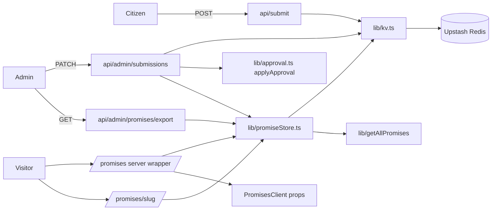
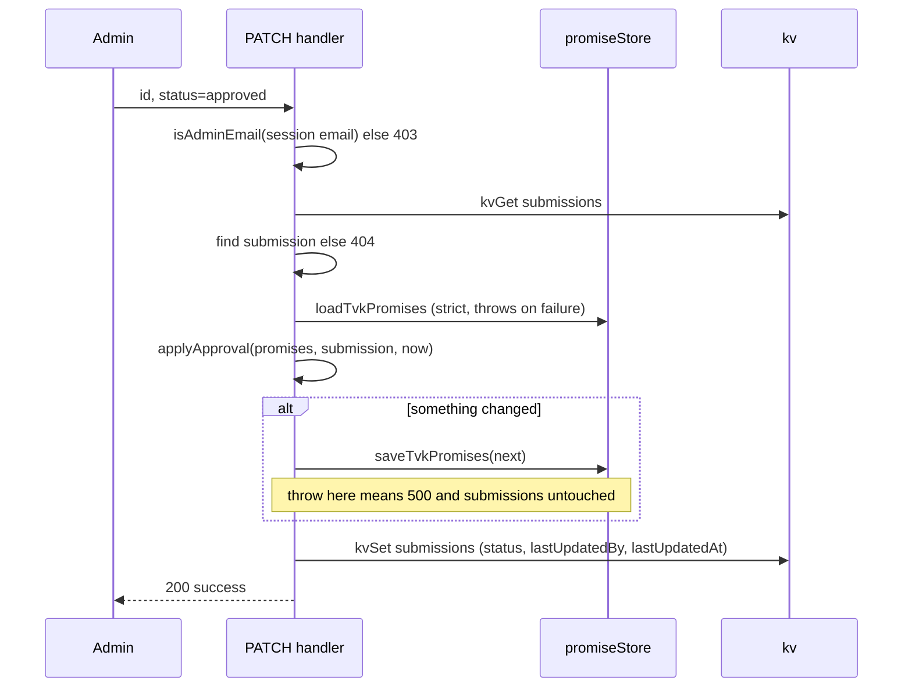

# Design Document

## Overview

TVK promises move into Upstash Redis under the key `promises`. Approving a submission in the admin API marks the linked promise `fulfilled` in Redis, and `/promises` and `/promises/[slug]` read Redis on every request. DMK promises and every other page keep reading static JSON through `lib/getAllPromises`.

The design is deliberately small:

- No new dependency. The existing fetch-based Upstash REST calls are extracted from the two routes into one file, `lib/kv.ts`.
- One new pure function, `applyApproval`, holds all approval logic.
- One new module, `lib/promiseStore.ts`, holds all Redis promise I/O, seeding, and the fallback.
- The admin route's private `isAdmin()` is deleted in favour of `isAdminEmail()` from `lib/config.ts`.
- The existing `/promises` client component is kept and receives promises as props from a new server wrapper.

### Design points

| Point | Decision |
| --- | --- |
| `promiseId` resolution | Exact match on `id` or `slug` against the Redis TVK list. Empty or unmatched is a miss, handled as "approve the submission, leave promises alone". |
| Seeding | Lazy. Only when a read finds the key absent or empty. No migration script, no startup hook. |
| Submit | `app/api/submit/route.ts` never imports the promise store. It cannot change a promise status. |
| Approval order | Write promises first, then the submission status. A failed promise write throws before the submission is touched. |
| `/promises` | Server wrapper `page.tsx` reads the store and passes `promises` to the existing client component. |
| Rendering | `export const dynamic = "force-dynamic"` on both pages, and every Redis `fetch` uses `cache: "no-store"`. |
| Export | `GET /api/admin/promises/export` returns Redis TVK plus static DMK as one JSON array. |
| Check | One assert-based file, run with Node's built-in TypeScript stripping. No test framework. |

### Discrepancy with the requirements glossary

The glossary says Seed_File holds both TVK and DMK promises. In the repo, `data/promises.json` holds only TVK (56 records, all `partyId: "tvk"`) and DMK lives in `data/dmk-promises.json` (142 records). The design avoids depending on either layout. The TVK seed is `allPromises.filter(p => p.partyId === "tvk")` and the DMK list is `allPromises.filter(p => p.partyId === "dmk")`, both taken from `lib/getAllPromises`. This also means the export (a merged TVK plus DMK array) is a superset of what `data/promises.json` holds today. A maintainer updating that file by hand should keep only the `tvk` records.

## Architecture



### Approval sequence



## Components and Interfaces

### `lib/kv.ts` (new, extracted)

The two helpers currently copy-pasted in `app/api/submit/route.ts` and `app/api/admin/submissions/route.ts`, generalised over the key. Same REST calls, same auth header, same JSON-string storage format, so existing `submissions` data stays readable.

```ts
function creds() {
  const url = process.env.KV_REST_API_URL
  const token = process.env.KV_REST_API_TOKEN
  if (!url) throw new Error("KV_REST_API_URL is not set")
  if (!token) throw new Error("KV_REST_API_TOKEN is not set")
  return { url, token }
}

export async function kvGet<T>(key: string): Promise<T | null> {
  const { url, token } = creds()
  const res = await fetch(`${url}/get/${key}`, {
    headers: { Authorization: `Bearer ${token}` },
    cache: "no-store",
  })
  if (!res.ok) throw new Error(`KV read failed (${key}): ${res.statusText}`)
  const { result } = await res.json()
  if (!result) return null
  return typeof result === "string" ? JSON.parse(result) : result
}

export async function kvSet(key: string, value: unknown): Promise<void> {
  const { url, token } = creds()
  const res = await fetch(`${url}/set/${key}`, {
    method: "POST",
    headers: { Authorization: `Bearer ${token}`, "Content-Type": "application/json" },
    body: JSON.stringify(value),
    cache: "no-store",
  })
  if (!res.ok) throw new Error(`KV write failed (${key}): ${res.statusText}`)
}
```

Callers replace their local helpers with `(await kvGet<Submission[]>("submissions")) ?? []` and `kvSet("submissions", submissions)`. The only behaviour change in the routes is the error message when env vars are missing, which now names the variable.

### `lib/approval.ts` (new, pure)

No imports other than `import type`, so Node can run it directly in the check file. No I/O, no clock access; the caller passes `now`.

```ts
import type { Promise as PromiseType, Submission } from "@/types"

export function applyApproval(
  promises: PromiseType[],
  sub: Pick<Submission, "promiseId" | "evidenceUrl" | "details">,
  now: string, // ISO timestamp
): PromiseType[] {
  const ref = sub.promiseId?.trim()
  if (!ref) return [...promises]
  return promises.map((p) => {
    if (p.id !== ref && p.slug !== ref) return p
    const has = p.sources.some((s) => s.url === sub.evidenceUrl)
    return {
      ...p,
      status: "fulfilled",
      lastUpdated: now.slice(0, 10),
      sources: has ? p.sources : [...p.sources, toSource(sub, now)],
    }
  })
}
```

Rules:

- Always returns a new array. Only the matched promise is replaced by a new object; unmatched promises are the same references. The input array and its objects are never mutated.
- Duplicate detection compares `evidenceUrl` to existing `source.url`. A duplicate leaves `sources` as it was, but status and `lastUpdated` are still applied.
- `toSource` maps a submission to the `Source` shape: `title: "Citizen-submitted evidence"`, `url: evidenceUrl`, `publication` = URL hostname, `date` = `now.slice(0, 10)`, `tier: 3`, `summary: details`. Tier 3 is the lowest source tier in `types/index.ts`, which fits unreviewed citizen evidence that an admin has accepted.
- The caller detects "something changed" with `next.some((p, i) => p !== promises[i])`, which is true only on a match. A miss therefore skips the Redis promise write.
- Reference matching is exact and case-sensitive. The submit form already passes ids from `/submit?promiseId=<id>`, so exact matching covers the main flow, and slugs cover free-text entry.

### `lib/promiseStore.ts` (new)

All Redis promise I/O in one place.

```ts
import allPromises from "@/lib/getAllPromises"
import { kvGet, kvSet } from "@/lib/kv"
import type { Promise as PromiseType } from "@/types"

const all = allPromises as PromiseType[]
const seed = all.filter((p) => p.partyId === "tvk")
const dmk = all.filter((p) => p.partyId === "dmk")

// Strict: throws on any Redis failure. Seeds the key if empty.
export async function loadTvkPromises(): Promise<PromiseType[]> {
  const stored = await kvGet<PromiseType[]>("promises")
  if (stored && stored.length > 0) return stored
  await kvSet("promises", seed)
  return seed
}

// Tolerant: for pages. Falls back to the seed and logs.
export async function getTvkPromises(): Promise<PromiseType[]> {
  try {
    return await loadTvkPromises()
  } catch (err) {
    console.error("Promise store unavailable, using seed:", err)
    return seed
  }
}

export async function saveTvkPromises(list: PromiseType[]): Promise<void> {
  await kvSet("promises", list.filter((p) => p.partyId === "tvk"))
}

// TVK from Redis, DMK from static. Used by both pages and the export.
export async function getLivePromises(): Promise<PromiseType[]> {
  return [...(await getTvkPromises()), ...dmk]
}
```

Why two read functions: the admin approval path must use the strict `loadTvkPromises`. If it used the tolerant one and Redis had a transient read error, the handler would receive the seed, apply one approval to it, and `saveTvkPromises` would overwrite every earlier approval in Redis. Pages want the opposite: an error page is worse than seed data (requirement 5.5).

`saveTvkPromises` filters to `partyId === "tvk"` so a DMK record can never reach Redis (requirements 1.1, 1.2).

### `app/api/admin/submissions/route.ts` (edited)

- Delete the local `getKVSubmissions`, `saveKVSubmissions`, and `isAdmin()`. Import `kvGet`, `kvSet`, and `isAdminEmail`.
- Both `GET` and `PATCH` use `isAdminEmail(session.user.email)`.
- `PATCH` becomes:

```ts
const submissions = (await kvGet<Submission[]>("submissions")) ?? []
const index = submissions.findIndex((s) => s.id === id)
if (index === -1) return 404

const now = new Date().toISOString()
if (status === "approved") {
  const promises = await loadTvkPromises()          // throws -> 500, nothing written
  const next = applyApproval(promises, submissions[index], now)
  if (next.some((p, i) => p !== promises[i])) await saveTvkPromises(next) // throws -> 500
}
submissions[index] = { ...submissions[index], status, lastUpdatedBy: email, lastUpdatedAt: now }
await kvSet("submissions", submissions)
```

The submission is only mutated after the promise write has succeeded, and the existing `catch` already turns any throw into HTTP 500 (requirement 3.7).

`pending` and `rejected` skip the `if` block, so promises are untouched (requirement 3.6). Un-approving a previously approved submission does not revert the promise; this is outside the requirements and stays that way.

Partial failure: if the promise write succeeds and the final submission write fails, the promise is `fulfilled` while the submission still reads `pending`. The admin gets a 500 and retries; because `applyApproval` is idempotent, the retry converges.

### Reconciling `isAdmin()` and `isAdminEmail()`

`lib/config.ts` is the single source of truth. Both implementations read `ADMIN_EMAILS`, split on commas, trim, and lower-case. They differ in one case, and that is a behaviour change to be aware of:

| `ADMIN_EMAILS` | Old local `isAdmin()` | `isAdminEmail()` |
| --- | --- | --- |
| Set | Email in list | Email in list |
| Unset or empty | Nobody is admin | The hardcoded default email is admin |

After the change, an environment without `ADMIN_EMAILS` grants admin to the default email in `lib/config.ts` instead of to nobody. That is the fallback `lib/config.ts` documents ("so existing deployments don't break"), and requirement 8 defines Admin by `isAdminEmail()`. The deployment should set `ADMIN_EMAILS` explicitly; I'm not changing `config.ts` in this feature.

### `app/api/submit/route.ts` (edited)

Only the extraction: remove the two local helpers and call `kvGet`/`kvSet`. No import of `promiseStore` or `approval`, so a submission can only be written as `pending` to the `submissions` key. Field set is unchanged.

### `app/api/admin/promises/export/route.ts` (new)

```ts
export const dynamic = "force-dynamic"

export async function GET() {
  const session = await getServerSession(authOptions)
  if (!isAdminEmail(session?.user?.email)) {
    return NextResponse.json({ error: "Access Denied" }, { status: 403 })
  }
  try {
    const merged = [...(await loadTvkPromises()), ...dmkPromises]
    return new NextResponse(JSON.stringify(merged, null, 2), {
      headers: {
        "Content-Type": "application/json",
        "Content-Disposition": 'attachment; filename="promises.json"',
        "Cache-Control": "no-store",
      },
    })
  } catch (error) { /* log, 500 */ }
}
```

- It uses the strict `loadTvkPromises`, not the tolerant one. An export that silently returns seed data when Redis is down would look correct and mislead the maintainer, so it fails with 500 instead.
- `dmkPromises` is exposed from `promiseStore.ts` as a small helper (for example `export const getDmkPromises = () => dmk`) so the export route and `getLivePromises` share one source. No file writes, no git calls (requirement 8.4).
- `JSON.stringify(..., null, 2)` matches the indentation style of a hand-edited JSON file so diffs stay readable.

### `app/promises/page.tsx` and `app/promises/PromisesClient.tsx`

- Move the current `page.tsx` to `PromisesClient.tsx` (`git mv`) and keep `"use client"`.
- Edit it minimally: drop `import promisesData from "@/lib/getAllPromises"`, and take `{ promises }: { promises: PromiseType[] }` as a prop. `PromisesPageContent` receives it and uses it wherever it used `promisesData`. The default export keeps the `Suspense` wrapper because `useSearchParams` still needs it.
- The new `page.tsx` is a server component:

```tsx
import PromisesClient from "./PromisesClient"
import { getLivePromises } from "@/lib/promiseStore"

export const dynamic = "force-dynamic"

export default async function PromisesPage() {
  return <PromisesClient promises={await getLivePromises()} />
}
```

### `app/promises/[slug]/page.tsx` (edited)

- Remove `generateStaticParams` (it forces a build-time list that conflicts with live data) and add `export const dynamic = "force-dynamic"`.
- Replace `promisesData` with `const promisesData = await getLivePromises()`. The existing slug lookup and `notFound()` stay as they are, so TVK slugs resolve from Redis and DMK slugs from the static list (requirements 6.1 to 6.3). Related promises are taken from the same live list.

### `lib/approval.check.ts` (new, the one check)

```ts
import assert from "node:assert/strict"
import { applyApproval } from "./approval.ts"
```

Run with `node --experimental-strip-types lib/approval.check.ts`, exposed as `"check"` in `package.json` scripts. Node 22.17 (installed here) needs the flag; Node 22.18 and later strip types by default. This needs one `tsconfig.json` addition, `"allowImportingTsExtensions": true`, which is valid because `noEmit` is already set. Without it `next build` type-checks this file and rejects the `.ts` import. `approval.ts` must stay free of enums and runtime-only TS features for stripping to work.

### `types/index.ts` (edited)

Add a `Submission` interface matching the existing stored shape, so the routes can drop `any[]`:

```ts
export type SubmissionStatus = "pending" | "approved" | "rejected"

export interface Submission {
  id: string
  promiseId: string | null
  evidenceUrl: string
  details: string
  status: SubmissionStatus
  submittedBy: { name: string; email: string; image: string | null }
  createdAt: string
  lastUpdatedBy?: string
  lastUpdatedAt?: string
}
```

## Data Models

| Key | Value | Written by | Read by |
| --- | --- | --- | --- |
| `submissions` | JSON array of `Submission`, stored as a JSON string (unchanged) | Submit_API, Admin_API | Admin_API, Submit_API |
| `promises` | JSON array of TVK `Promise` only, stored as a JSON string | `saveTvkPromises`, lazy seed | `loadTvkPromises` |

The `Promise` shape is unchanged. Approval touches three fields on one record: `status`, `lastUpdated`, `sources`.

Environment variables: `KV_REST_API_URL`, `KV_REST_API_TOKEN` (existing), `ADMIN_EMAILS` (existing). No new variables.

Size: the REST write sends the whole `promises` array in one request body. 56 records is well under Upstash request-size limits; revisit if the list grows by an order of magnitude.

## Error Handling

| Situation | Behaviour |
| --- | --- |
| Env var missing | `kvGet`/`kvSet` throw `KV_REST_API_URL is not set` or `KV_REST_API_TOKEN is not set`. |
| Redis failure on `/promises` or `/promises/[slug]` | `getTvkPromises` logs and returns the seed; page renders normally. |
| Redis failure on approval read | `loadTvkPromises` throws, handler returns 500, nothing written. |
| Promise write fails on approval | Throw, 500, submission status unchanged. |
| Promise write succeeds, submission write fails | 500; promise is already fulfilled; retrying is safe (idempotent). |
| Approved submission with empty or unknown `promiseId` | Submission saved as `approved`, promises untouched, no promise write. |
| Non-admin or unauthenticated on admin routes | 403. |
| Export when Redis is unreachable | 500, not seed data. |
| Unknown slug on detail page | `notFound()`. |

Known ceiling, marked in code with a `ponytail:` comment on the read-modify-write in the PATCH handler: two admins approving at the same moment can lose one update, because the whole array is read, changed, and written back. This is the same pattern already used for `submissions`, and admin traffic is low. The upgrade path is one hash field per promise (`HSET`) or an atomic script.

## Correctness Properties

These statements describe behavior that should hold across all valid executions of the system. They link the requirements to checks that a machine can run.

Reflection on redundancy: criteria 3.1, 3.2, and 3.3 all describe one transformation of the matched promise, so they are one property. Criteria 1.1, 1.2, 5.2, and 8.2 all describe how TVK and DMK lists are combined or filtered, so they are one property. Criteria about I/O ordering, config, rendering mode, and auth (1.3 to 1.5, 2.x, 3.6, 3.7, 4.x, 5.1, 5.3 to 5.5, 6.x, 7.x, 8.1, 8.3, 8.4) are covered by build checks and manual examples rather than properties.

### Property 1: Approval applies to the matched promise

For any list of promises and any submission whose `promiseId` equals the `id` or the `slug` of exactly one promise in the list, `applyApproval` returns a list in which that promise has `status` `fulfilled`, `lastUpdated` equal to the date part of `now`, and `sources` containing the submission's `evidenceUrl`.

**Validates: Requirements 3.1, 3.2, 3.3**

### Property 2: Approval is idempotent and never duplicates evidence

For any list of promises and any submission, applying `applyApproval` twice with the same `now` yields the same result as applying it once, and no promise ever lists the same `evidenceUrl` twice in `sources` as a result.

**Validates: Requirements 3.4**

### Property 3: A miss leaves every promise unchanged

For any list of promises and any submission whose `promiseId` is null, empty, whitespace, or matches no promise `id` or `slug`, `applyApproval` returns a list deeply equal to the input.

**Validates: Requirements 3.5**

### Property 4: Approval does not mutate its input

For any list of promises and any submission, after calling `applyApproval` the input list and every object in it are deeply equal to a snapshot taken before the call, the returned list is a different array, and every promise other than the matched one is unchanged in the output.

**Validates: Requirements 3.8**

### Property 5: Live list is Redis TVK plus static DMK, and only TVK is written

For any stored TVK list and any static DMK list, `getLivePromises` returns the TVK records followed by the DMK records with none added or dropped, and for any list passed to `saveTvkPromises` the value written to the key `promises` contains only records with `partyId` `tvk`.

**Validates: Requirements 1.1, 1.2, 5.2, 8.2**

## Testing Strategy

Per the lean brief there is no test framework and no property-testing library. The single check file `lib/approval.check.ts` covers Properties 1 to 4 with `node:assert` over a small hand-built promise list. This is a deliberate shortcut: the asserts check representative cases rather than generated inputs, so they can miss unusual inputs. If the approval rules grow, the upgrade path is a property-testing library that generates the lists.

The check file contains these cases (requirement 9.2):

1. Match by `id`: status `fulfilled`, source appended, `lastUpdated` set (Property 1).
2. Match by `slug`: same result (Property 1).
3. Miss, covering an unknown reference, an empty string, and `null`: output deep-equals input (Property 3).
4. Duplicate `evidenceUrl`: `sources` length and contents unchanged; applying twice equals applying once (Property 2).
5. Input untouched: deep-freeze the input before the call so any mutation throws, and assert the output is a different array (Property 4).

Property 5 depends on Redis I/O and static imports, so it is verified by reading the code and by a manual run:

- `npm run check` passes.
- `npm run build` and `npm run lint` pass; build output lists `/promises` and `/promises/[slug]` as dynamic.
- With Upstash configured: first `/promises` request seeds the key; approving a matching submission in `/admin/submissions` shows the promise as fulfilled on the next `/promises` load; submitting new evidence leaves all statuses alone; the export downloads one array with both parties.
- With the env vars unset: `/promises` still renders from seed, and `PATCH` returns 500 naming the missing variable.
- Non-admin session on the PATCH and export routes returns 403.

## File Summary

| File | Change |
| --- | --- |
| `lib/kv.ts` | new, extracted from the two routes |
| `lib/approval.ts` | new, pure `applyApproval` |
| `lib/promiseStore.ts` | new, Redis promise read, save, seed, fallback |
| `lib/approval.check.ts` | new, the one assert-based check |
| `app/api/admin/promises/export/route.ts` | new |
| `app/promises/PromisesClient.tsx` | moved from `page.tsx`, takes `promises` prop |
| `app/promises/page.tsx` | now a server wrapper |
| `app/promises/[slug]/page.tsx` | live data, dynamic, no `generateStaticParams` |
| `app/api/admin/submissions/route.ts` | uses `kv`, `isAdminEmail`, approval flow |
| `app/api/submit/route.ts` | uses `kv` only |
| `types/index.ts` | add `Submission` |
| `tsconfig.json` | add `allowImportingTsExtensions` |
| `package.json` | add `"check"` script |

Unchanged: `lib/getAllPromises.ts`, `lib/config.ts`, all other pages, all data files.
